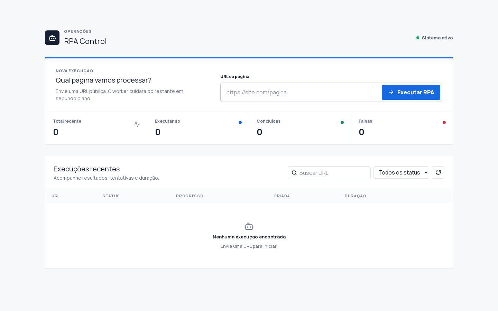
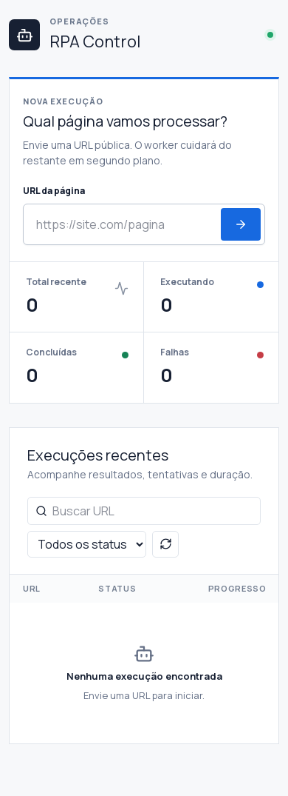
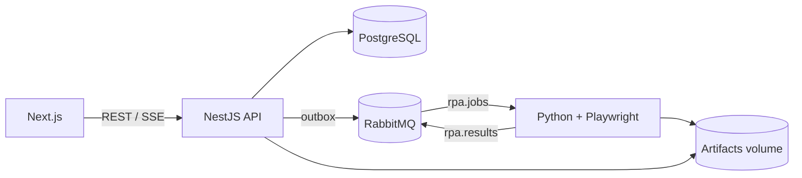
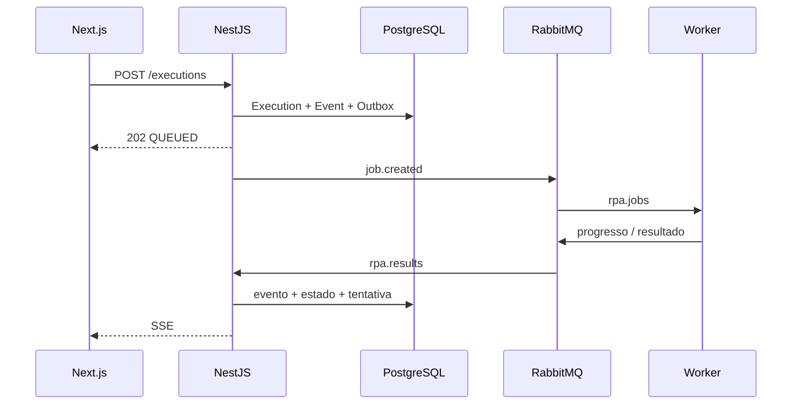

# RPA Control

Plataforma para executar automações web de forma assíncrona. O frontend envia uma URL, a API registra a execução e publica um job no RabbitMQ, e o worker Python usa Playwright para navegar, capturar uma screenshot e extrair o título e os dez primeiros links.

## Serviços

| Serviço | Stack | Responsabilidade | Documentação |
|---|---|---|---|
| **Frontend** | Next.js, React, TypeScript e Tailwind | Envio de URLs, histórico, progresso, timeline e resultados | [`frontend/README.md`](frontend/README.md) |
| **API** | NestJS, Prisma, PostgreSQL e RabbitMQ | API REST, SSE, persistência, idempotência e mensageria | [`api/README.md`](api/README.md) |
| **RPA Worker** | Python, Playwright e aio-pika | Consumo dos jobs, automação, screenshots, retry e publicação do resultado | [`rpa/README.md`](rpa/README.md) |

Cada serviço possui dependências, Dockerfile e documentação próprios. A raiz contém apenas a orquestração e a documentação compartilhada.

## Interface

| Desktop | Mobile |
|---|---|
|  |  |

## Arquitetura



- **Frontend:** criação, filtros, histórico, progresso, timeline, resultado e screenshots.
- **API:** validação, idempotência, persistência, outbox transacional, consumo de eventos, Swagger e SSE.
- **Worker:** Playwright isolado por job, progresso, timeout, retry, DLQ e graceful cleanup.
- **RabbitMQ:** desacopla o request HTTP do processamento demorado e oferece backpressure e entrega `at-least-once`.
- **PostgreSQL:** fonte de verdade para execuções, tentativas, eventos e artefatos.

## Início rápido

Pré-requisito: Docker com Docker Compose.

```bash
cp .env.example .env
docker compose up --build -d
docker compose ps
```

Acessos locais:

| Serviço | URL |
|---|---|
| Painel | http://localhost:3000 |
| API | http://localhost:3001 |
| Swagger | http://localhost:3001/docs |
| RabbitMQ Management | http://localhost:15672 |

As credenciais locais padrão do RabbitMQ são `rpa` / `rpa_local`. Troque todas as senhas antes de expor o ambiente.

Para encerrar:

```bash
docker compose down
```

Use `docker compose down -v` somente quando quiser apagar banco, filas e artefatos.

## Fluxo de execução



Estados: `QUEUED`, `PROCESSING`, `SUCCESS`, `FAILED` e `CANCELLED`. O último está reservado para evolução futura.

## API

### Criar execução

```bash
curl -X POST http://localhost:3001/executions \
  -H 'Content-Type: application/json' \
  -H 'Idempotency-Key: minha-requisicao-001' \
  -d '{"url":"https://example.com"}'
```

Resposta:

```json
{ "id": "uuid", "status": "QUEUED" }
```

Repetir a mesma chamada com a mesma chave retorna a execução original.

| Método | Endpoint | Descrição |
|---|---|---|
| `POST` | `/executions` | Enfileira uma URL pública |
| `GET` | `/executions` | Lista e filtra por `status`, `search`, `limit` e `cursor` |
| `GET` | `/executions/:id` | Detalhe, timeline, tentativas e artefatos |
| `GET` | `/executions/:id/stream` | Eventos em tempo real por SSE |
| `GET` | `/executions/:id/artifacts/:artifactId` | Visualiza um artefato |
| `GET` | `/health` | Liveness da API |

## Filas e confiabilidade

- `rpa.jobs`: jobs prontos para consumo.
- `rpa.jobs.retry`: espera 10 segundos antes de retornar o job à fila principal.
- `rpa.results`: eventos duráveis consumidos pela API.
- `rpa.dlq`: jobs que excederam `MAX_ATTEMPTS`.

A criação usa outbox no mesmo commit da execução. Mensagens e eventos possuem IDs para deduplicação. O worker só confirma o job depois de confirmar a publicação do resultado. O bot atual é somente leitura; automações futuras com efeitos externos devem implementar idempotência específica do domínio.

## Segurança de URL

A API e o worker aceitam apenas HTTP/HTTPS público. Credenciais na URL, localhost, IPs privados/reservados e redirects para redes privadas são bloqueados para reduzir risco de SSRF. Não há autenticação nesta primeira versão; use a aplicação apenas em rede confiável ou adicione uma camada de identidade antes da exposição pública.

## Configuração

Consulte `.env.example`. Variáveis principais:

| Variável | Padrão | Uso |
|---|---|---|
| `DATABASE_URL` | PostgreSQL do Compose | Persistência da API |
| `RABBITMQ_URL` | RabbitMQ do Compose | API e worker |
| `WORKER_CONCURRENCY` | `2` | Jobs simultâneos por worker |
| `MAX_ATTEMPTS` | `3` | Limite antes da DLQ |
| `JOB_TIMEOUT_SECONDS` | `120` | Timeout total do job |
| `TIMEOUT_MS` | `30000` | Timeout das ações Playwright |
| `HEADLESS` | `true` | Chromium sem interface |
| `ARTIFACTS_DIR` | `/artifacts` | Screenshots persistentes |

## Desenvolvimento local

### API

```bash
cd api
npm install
npx prisma generate
npm run start:dev
```

A API requer PostgreSQL e RabbitMQ. Você pode subi-los com `docker compose up -d postgres rabbitmq` e ajustar as URLs para `localhost`.

### Frontend

```bash
cd frontend
npm install
NEXT_PUBLIC_API_URL=http://localhost:3001 npm run dev
```

### Worker e modo standalone

O modo standalone original foi preservado:

```bash
cd rpa
python3 -m venv .venv
source .venv/bin/activate
pip install -r requirements.txt
playwright install chromium
TARGET_URL=https://example.com python bot.py
```

Nesse modo o bot abre Chromium, navega até `TARGET_URL`, captura screenshot, extrai título e links e grava logs rotacionados em `rpa.log`. Para consumir RabbitMQ, execute `python worker.py` com `RABBITMQ_URL` configurado.

## Testes e diagnóstico

```bash
cd api && npm test && npm run build
cd ../frontend && npm run lint && npm run build
cd .. && python3 -m py_compile rpa/*.py
docker compose config --quiet
docker compose logs -f api rpa-worker
```

Para inspecionar falhas definitivas, abra RabbitMQ Management e consulte `rpa.dlq`. Se a API não iniciar, confira migrations e conectividade com PostgreSQL; se o worker reiniciar, confira memória compartilhada, DNS da URL e dependências do Chromium.

## Estrutura

```text
.
├── frontend/                       # Interface Next.js
│   ├── src/app/                    # Rotas finas e estilos globais
│   ├── src/features/executions/    # UI, hooks, tipos e API da feature
│   ├── src/lib/                    # HTTP e formatação compartilhados
│   ├── Dockerfile
│   └── README.md
├── api/                            # API NestJS
│   ├── src/executions/             # Casos de uso e endpoints
│   ├── src/messaging/              # Conexão, contratos, outbox e consumidores
│   ├── src/prisma/                 # Cliente PostgreSQL
│   ├── prisma/migrations/          # Schema e migrations
│   ├── Dockerfile
│   └── README.md
├── rpa/                            # Worker Python
│   ├── bot.py                      # Automação Playwright reutilizável
│   ├── worker.py                   # Consumidor RabbitMQ
│   ├── config.py                   # Configuração por ambiente
│   ├── Dockerfile
│   └── README.md
├── docs/images/                    # Imagens usadas na documentação
├── docker-compose.yml              # Orquestração da plataforma
├── .env.example                    # Contrato de configuração
└── README.md                       # Visão geral e operação integrada
```
