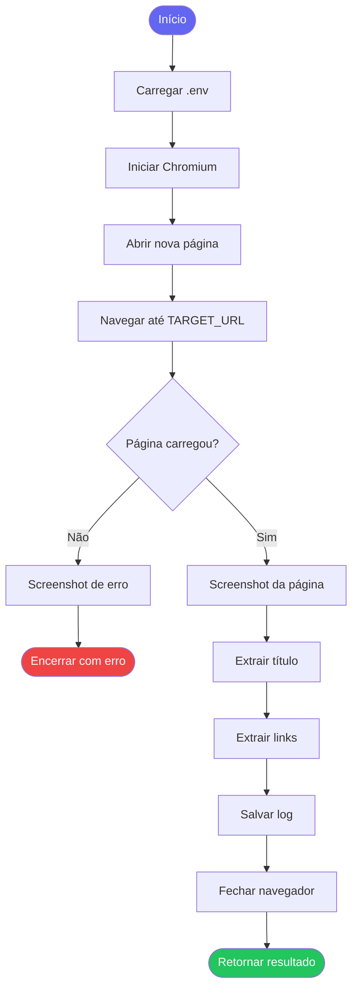

# RPA Playwright Automation

Bot de automação web usando Python + Playwright. Navega em páginas, captura screenshots e extrai dados.

## Fluxo de execução



## Tecnologias

- Python 3.11+
- Playwright (Chromium headless)
- Loguru (logs estruturados)
- python-dotenv

## Instalação

```bash
pip install -r requirements.txt
playwright install chromium
```

## Configuração

Copie `.env.example` para `.env` e ajuste as variáveis:

```bash
cp .env.example .env
```

| Variável | Descrição | Padrão |
|---|---|---|
| `TARGET_URL` | URL alvo do bot | `https://exemplo.com` |
| `HEADLESS` | Rodar sem interface | `true` |
| `TIMEOUT_MS` | Timeout em ms | `30000` |
| `OUTPUT_DIR` | Pasta de downloads | `./downloads` |

## Uso

```bash
python bot.py
```

O bot vai:
1. Abrir o navegador (Chromium)
2. Navegar até a URL configurada
3. Capturar screenshot da página
4. Extrair título e primeiros links
5. Salvar logs em `rpa.log`

## Estrutura

```
rpa-playwright-automation/
├── bot.py          # Lógica principal do bot
├── config.py       # Carregamento de configurações
├── requirements.txt
├── .env.example
└── screenshots/    # Screenshots capturados (auto-criado)
```

## Logs

Logs são salvos em `rpa.log` com rotação automática (10 MB, 7 dias de retenção).
